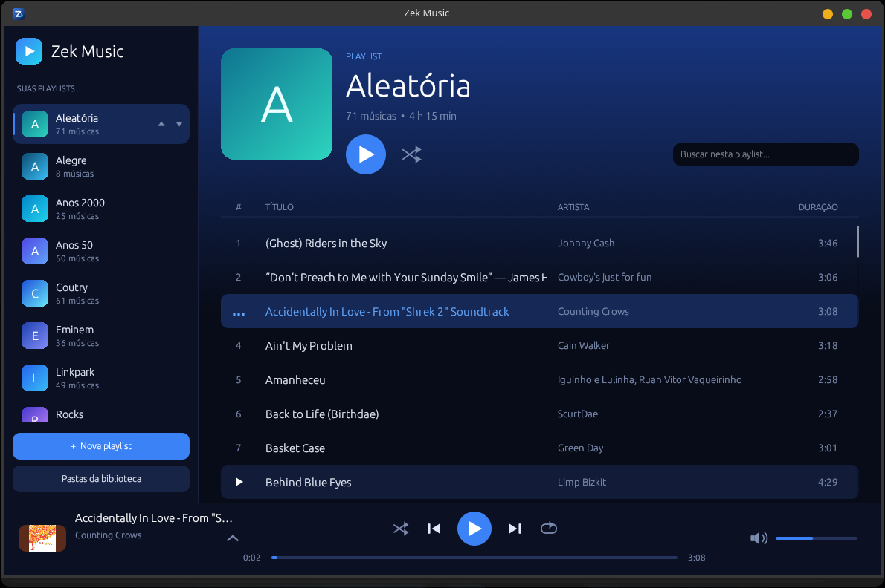
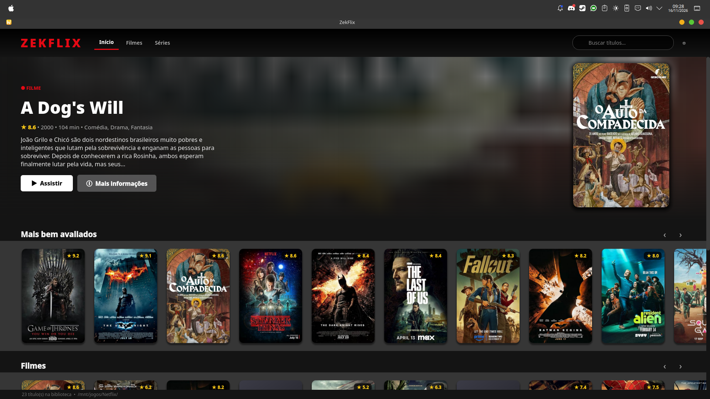
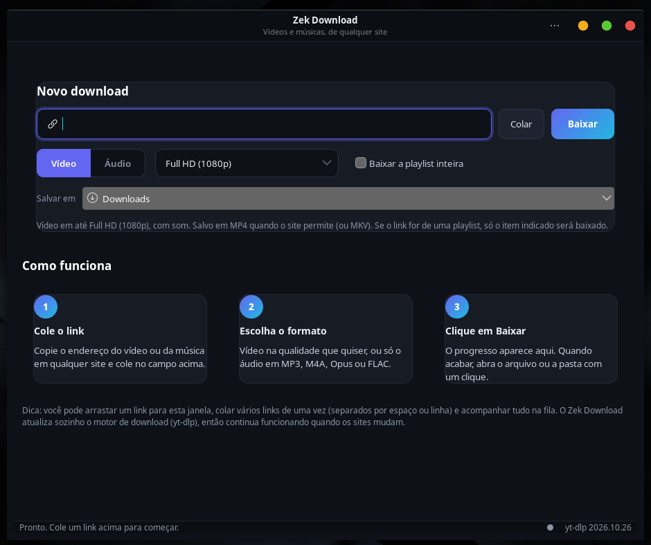
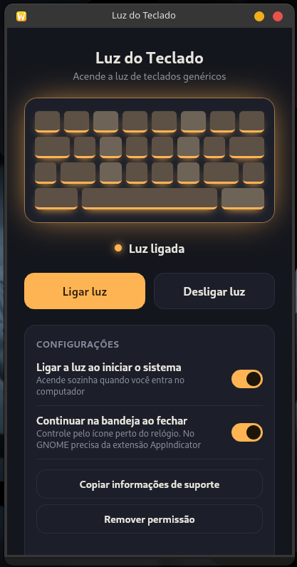

# Olá, eu sou Aaaiiicerol 👋

### 🎮 Games &nbsp;•&nbsp; 🐧 Linux &nbsp;•&nbsp; 🎬 Vídeos

Faço vídeos sobre **games e Linux** e crio programinhas para deixar a vida no Linux mais fácil.

---

## 🚀 Meus Projetos

Ferramentas open-source (MIT) para mídia e workflow no Linux — todas distribuídas como **AppImage** (baixe, dê permissão e rode).

### 🎵 Zek Music
**Player leve onde cada pasta vira uma playlist** · Feito em Rust · [Releases](https://github.com/aaaiiicerol/zek-music/releases/latest)

---

### 🎬 ZekFlix
**Seus filmes e séries locais em interface estilo Netflix** · Tauri + Rust · [Releases](https://github.com/aaaiiicerol/zekflix/releases/latest)

---

### 📥 Zek Download
**Baixe vídeos/áudio de milhares de sites** · Interface simples · yt-dlp · Auto-atualização · [Releases](https://github.com/aaaiiicerol/zek-download-windows/releases/latest)

---

### 💡 Luz do Teclado
**Liga/desliga luz de teclados genéricos no Linux** · Sem terminal · AppImage · [Releases](https://github.com/aaaiiicerol/luz-teclado/releases/latest)

---

<!-- PROJETOS:START -->
| Projeto | O que faz |
|---|---|
| [Aaaiiicerol.Github.Io](https://github.com/aaaiiicerol/aaaiiicerol.github.io) |  |
| [Zek Download Windows](https://github.com/aaaiiicerol/zek-download-windows) |  |
| [Zek Download](https://github.com/aaaiiicerol/zek-download) |  |
| [Zekflix](https://github.com/aaaiiicerol/zekflix) | ZekFlix: seus filmes e séries locais em uma interface estilo Netflix para Linux |
| [Zek Music](https://github.com/aaaiiicerol/zek-music) | Player de músicas leve para Linux e Windows onde cada pasta vira uma playlist. Feito em Rust. |
| [Luz Teclado](https://github.com/aaaiiicerol/luz-teclado) | Liga e desliga a luz de teclados genéricos no Linux (AppImage) |
<!-- PROJETOS:END -->

> 💡 **Dica**: Clique nas imagens acima para ir direto ao repositório de cada projeto.

---

## 🛠️ Tecnologias que uso

**Core**  

**GUI & Frameworks**  

**Media & Tools**  

**CI/CD**  

---

## 📊 Estatísticas

---

### 📺 Gostou? Vem ver os vídeos no canal **[@aaaiiiceroll](https://www.youtube.com/@Aaaiiiceroll)**

Sugestões de programas para games no Linux? Abra uma *issue* em qualquer projeto. 💙

🌐 Todos os projetos reunidos em um só lugar: **[aaaiiicerol.github.io](https://aaaiiicerol.github.io/)**

---

*Perfil atualizado automaticamente via GitHub Actions • Última atualização: `{{DATE}}`*

